<picture>
  <source media="(prefers-color-scheme: dark)" srcset="art/header-dark.svg">
  
</picture>

<div align="center">

### Olá, eu sou a Ariany! 👋🏽

**Estudante de Sistemas de Informação, técnica em Informática e entusiasta da área de dados.**  
Transformo informações em soluções organizadas, úteis e fáceis de compreender.

[](https://www.linkedin.com/in/arianybsilva)
[](mailto:arianybsilva.bsi@gmail.com)


</div>

---

## Sobre mim

```python
ariany = {
    "formação": "Sistemas de Informação — UFU",
    "base_técnica": "Técnico em Informática — IF Goiano",
    "principal_competência": "SQL",
    "interesses": ["Banco de Dados", "Análise de Dados", "Engenharia de Dados"],
    "em_evolução": ["Python", "PySpark", "Power BI", "Databricks"],
    "modo_de_trabalhar": ["colaboração", "organização", "documentação", "Scrum"]
}
```

- 🎓 Graduanda em **Sistemas de Informação na Universidade Federal de Uberlândia**.
- 💾 Gosto de trabalhar na interseção entre **dados, tecnologia e organização de processos**.
- 📊 Tenho domínio de **SQL** e conhecimentos em Python, PySpark, Power BI e Excel.
- ⚙️ Estou aprofundando conceitos de ETL, pipelines, qualidade e governança de dados.
- 🤝 Também atuo com documentação técnica, planejamento e acompanhamento de projetos colaborativos.
- 🌱 Acredito que tecnologia bem construída começa com curiosidade, clareza e propósito.

## Tecnologias e ferramentas

<div align="center">

### Dados e programação


### Bancos de dados e visualização


### Desenvolvimento e colaboração


</div>

> **Nota:** as tecnologias acima representam diferentes níveis de experiência. SQL é hoje minha competência mais consolidada; as demais fazem parte da minha prática e evolução contínua.

## Projetos e iniciativas

### 🧠 Mentes Brilhantes

Projeto de extensão da UFU que ajudei a cocriar e no qual atuo como **cofundadora e extensionista**. Participo do planejamento das atividades, elaboração de materiais, documentação e articulação com uma equipe multidisciplinar.

### 🚀 Ordinum

Colaboração na concepção e estruturação de uma iniciativa de software house, apoiando o planejamento de projetos, a organização de atividades e a construção de uma dinâmica de trabalho colaborativa.

### 💻 Projetos acadêmicos de TI

Desenvolvimento de sistemas envolvendo SQL, bancos de dados relacionais e programação. Também atuei como **Scrum Master**, organizando atividades, registros, apresentações e relatórios para facilitar o acompanhamento das entregas.

## Minha jornada em dados

```text
Dados brutos → organização → qualidade → análise → informação útil → decisão
```

Tenho interesse em compreender o caminho completo dos dados: desde sua modelagem e armazenamento até a transformação, análise, visualização e uso responsável. Estou construindo essa jornada com atenção especial a **qualidade de dados, governança e LGPD**.

## GitHub em números

<div align="center">


</div>

## Contribuições

<div align="center">

<picture>
  <source media="(prefers-color-scheme: dark)" srcset="https://raw.githubusercontent.com/anyany-dev/anyany-dev/output/github-contribution-grid-snake-dark.svg">
  <source media="(prefers-color-scheme: light)" srcset="https://raw.githubusercontent.com/anyany-dev/anyany-dev/output/github-contribution-grid-snake.svg">
  
</picture>

</div>

---

<div align="center">

### Vamos transformar dados e ideias em soluções? ✨

[](https://www.linkedin.com/in/arianybsilva)
[](mailto:arianybsilva.bsi@gmail.com)


</div>
